# Restaurant POS & Table Management

A touchscreen point-of-sale for a restaurant: a live floor plan, orders for dine-in,
takeaway and delivery, a kitchen display with timers, checkout with discounts and split
payments, invoices, reports, and screens for each staff role. It is **offline-first**:
everything is saved on the device, keeps working without internet, and syncs to a (mock)
server when the connection is back.

Built with **Next.js 16 (App Router), TypeScript (strict) and Tailwind CSS 4**.

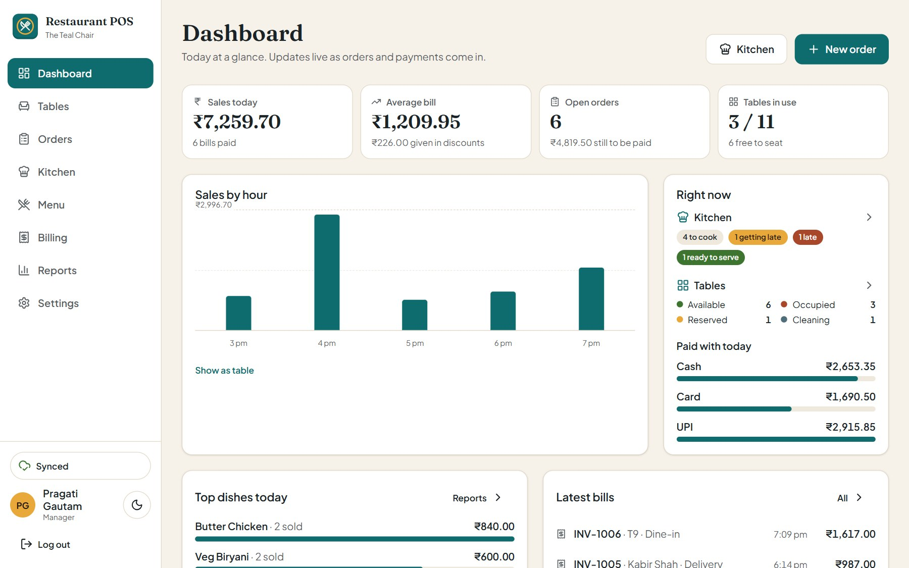

> Frontend project: there is no real backend. A mock API runs inside the browser and
> behaves like a real server (delay, errors, validation). See
> [docs/ARCHITECTURE.md](docs/ARCHITECTURE.md#offline-first-and-sync).

---

## Quick start

Requirements: **Node.js 20.9 or newer** (developed on Node 24) and npm.

```bash
npm install
npm run dev
```

Open <http://localhost:3000> (it goes straight to the login). Tap your name, then type the
PIN **1234** on the next page.

| User           | Role          | Can open                             |
| -------------- | ------------- | ------------------------------------ |
| Pragati Gautam | Manager       | Every page                           |
| Arushi Sharma  | Cashier       | Dashboard, Tables, Orders, Billing   |
| Vikram Joshi   | Waiter        | Tables, Orders                       |
| Farhan Qureshi | Kitchen staff | Kitchen, Menu (mark dishes sold out) |

**It starts clean.** A first visit opens on a fresh day: the sample menu, floor plan and
staff are there, but no orders or bills, like a real restaurant before opening. To see it
busy, log in as the manager and tap **Load sample service** (on the dashboard, or in
Settings): six orders in progress and six bills paid earlier today, all timed from the
moment you load them. **Settings → Start fresh** clears everything again.

**Showing it to someone?** Follow the 10-minute walkthrough in [docs/DEMO.md](docs/DEMO.md).

To try **offline loading** (service worker), use the production build, which the dev server
doesn't run:

```bash
npm run build
npm start
```

---

## What it does

| Area           | Highlights                                                                                                                                                                                                              |
| -------------- | ----------------------------------------------------------------------------------------------------------------------------------------------------------------------------------------------------------------------- |
| **Login**      | The home page. A dining-room photo on one side, staff names on the other. Tap a name to open that person's PIN page, which lists the pages their role can open. Keyboard works too; 5 wrong PINs lock the pad for 30 s. |
| **Tables**     | Floor plan with live status (available, occupied, reserved, cleaning), order totals and time seated. Move orders, join tables for big groups. Drag-and-drop floor plan editor (mouse, touch or keyboard).               |
| **Orders**     | Dine-in, takeaway and delivery. Menu with sizes, add-ons and required options, notes, sold-out dishes blocked. Add dishes, cancel dishes or orders (with reasons), split an order into separate bills.                  |
| **Kitchen**    | New → Preparing → Ready columns, one tap to move a ticket, live timers (amber at 10 min, red at 15), cooks' notes, a "to cook now" count across tickets, a sold-out shortcut.                                           |
| **Billing**    | Bill with discount (% or ₹, with a reason) and GST. Cash with change, card, UPI, and split payments (equal shares or any amounts). Printable GST invoice. Transaction history with takings per method.                  |
| **Dashboard**  | Today, live: sales, average bill, open orders, tables in use, sales by hour, kitchen status, top dishes, latest bills.                                                                                                  |
| **Reports**    | Today / yesterday / 7 / 30 days: totals, discounts, GST (CGST + SGST), sales by hour, payment methods, order types, dish sales, cancellations, **CSV export**.                                                          |
| **Menu**       | Dishes with photos, categories, sizes, add-ons and option groups; mark sold out.                                                                                                                                        |
| **Settings**   | Restaurant details (printed on invoices), GST rate, kitchen timers, theme, load the sample service or start fresh. Managers only.                                                                                       |
| **Everywhere** | Role-based screens and permissions, light and dark themes, touch-sized controls (44 px+), works offline, sync status in the header.                                                                                     |

---

## Screenshots

Production build with the sample service loaded, on a 1440 × 900 screen.

<table>
  <tr>
    <td width="50%">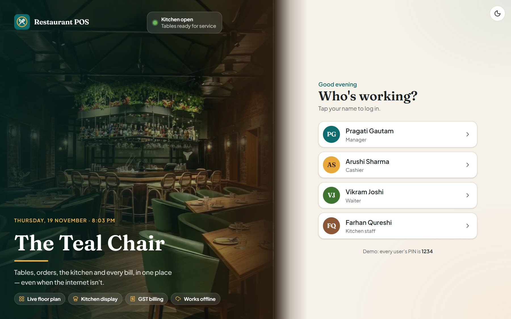<br><b>Login</b>: tap your name…</td>
    <td width="50%">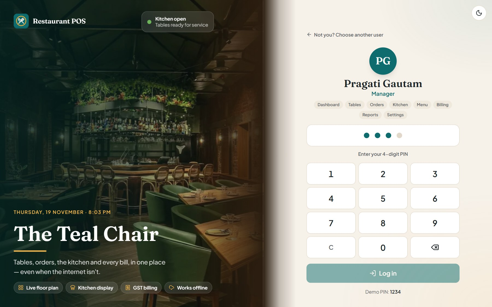<br>…then your PIN. The pages your role can open are listed.</td>
  </tr>
  <tr>
    <td>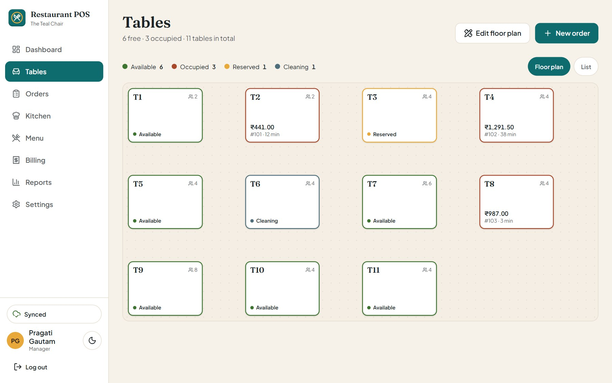<br><b>Tables</b>: live status, bill so far, minutes seated.</td>
    <td>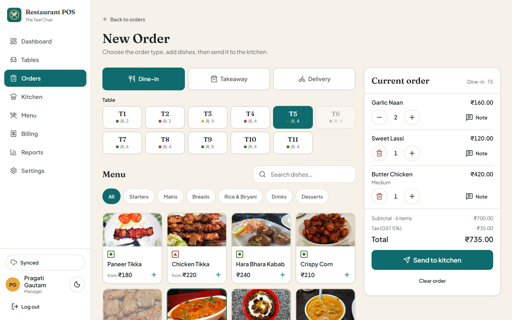<br><b>New order</b>: dishes with sizes and options; the bill adds up live.</td>
  </tr>
  <tr>
    <td>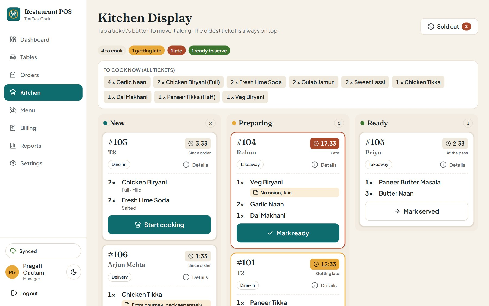<br><b>Kitchen</b>: one tap per step, timers turn amber then red.</td>
    <td>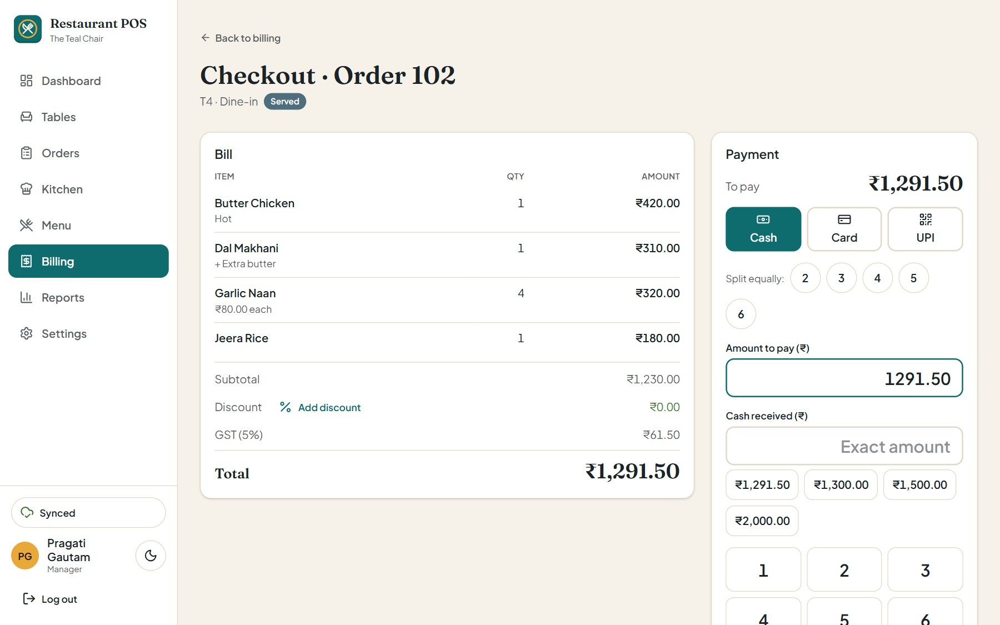<br><b>Checkout</b>: discounts, GST, cash with change, card, UPI, split bills.</td>
  </tr>
  <tr>
    <td>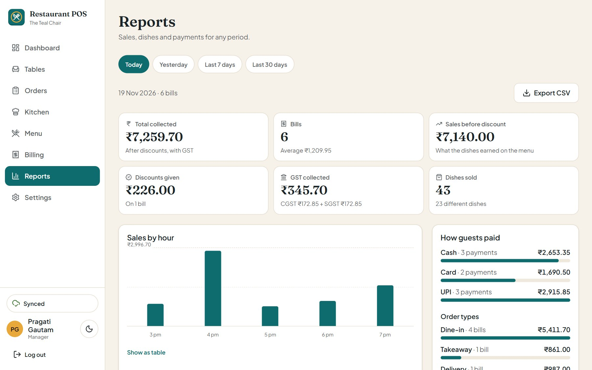<br><b>Reports</b>: totals, CGST + SGST, sales by hour, CSV export.</td>
    <td>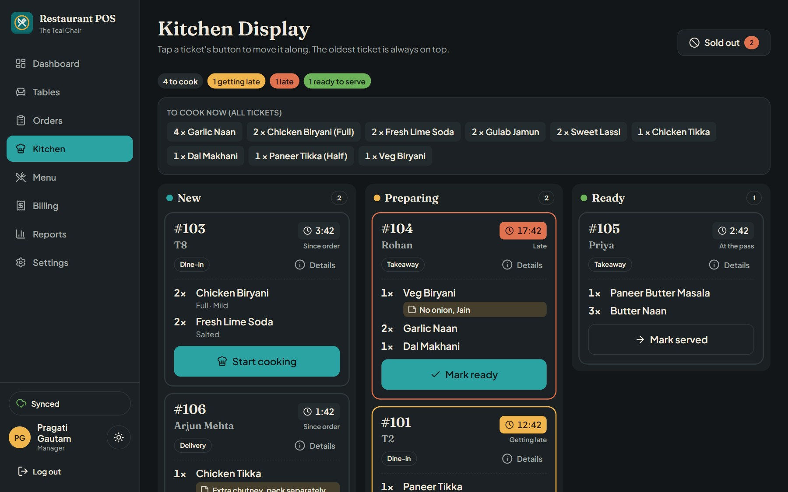<br><b>Dark mode</b>: every screen, every text checked for contrast.</td>
  </tr>
</table>

<p align="center">
  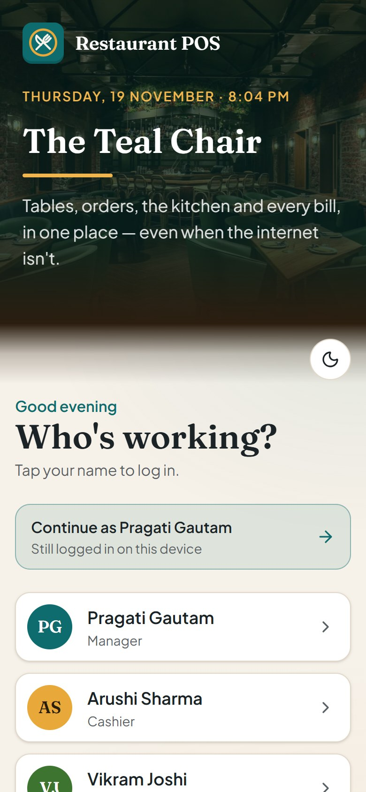
  &nbsp;&nbsp;
  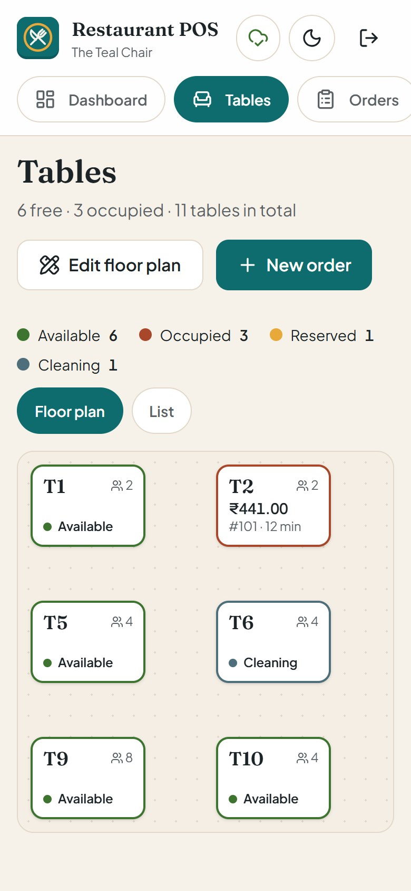
  <br><b>On a phone</b>: the same app, laid out for one hand.
</p>

---

## Scripts

| Command              | What it does                                                               |
| -------------------- | -------------------------------------------------------------------------- |
| `npm run dev`        | Development server on <http://localhost:3000>                              |
| `npm run build`      | Production build                                                           |
| `npm start`          | Run the production build (enables the offline service worker)              |
| `npm test`           | Run all tests once (Vitest)                                                |
| `npm run test:watch` | Tests in watch mode                                                        |
| `npm run typecheck`  | Generates Next.js route types (`next typegen`), then runs TypeScript       |
| `npm run lint`       | ESLint                                                                     |
| `npm run format`     | Prettier (with Tailwind class sorting)                                     |
| `npm run check`      | **Everything:** format check, lint, typecheck, tests, build (CI runs this) |

---

## How it's built

```
src/
├── app/          Pages (routes). Thin: they arrange components from features/.
├── features/     One folder per area: tables, orders, kitchen, billing, menu, …
├── components/   Shared UI (buttons, dialogs, …), the app shell, the logo
├── domain/  ⭐   The business rules: pure TypeScript, no React, fully tested
├── stores/       Zustand stores: apply domain rules, check roles, save to IndexedDB
├── lib/          Plumbing: IndexedDB persistence, sync engine, validation, helpers
├── mocks/        Sample data and the mock API server
├── types/        The shapes of orders, tables, invoices, …
└── config/       Navigation and defaults
```

The key idea: **all business rules live in `domain/` as pure functions** (money, billing,
order and table state machines, payments, permissions, reports, sync). Stores call them
and save the result in **one update**, so if a rule says no, nothing changes. Screens only
call store actions. Details in [docs/ARCHITECTURE.md](docs/ARCHITECTURE.md).

A few decisions that matter for correctness:

- **Money is whole paise** (₹125.50 = `12550`), never floating point. Percentages are basis
  points (5% = `500`). Rounding happens in exactly two places (discount, tax), half-up.
- **State machines** decide which order and table moves are legal (an order can't be paid
  before it's served; a dirty table can't be seated).
- **Invoices are frozen** copies of the bill at payment time, so history never changes.
- **Every store action checks the role**, so hiding a button is a convenience, not the
  security.

All the rules, with examples: [docs/BUSINESS_RULES.md](docs/BUSINESS_RULES.md).

### Tech stack

| Concern       | Choice                                                        |
| ------------- | ------------------------------------------------------------- |
| Framework     | Next.js 16.4 (App Router, Turbopack, Cache Components)        |
| Language      | TypeScript 5, strict                                          |
| Styling       | Tailwind CSS 4, design tokens in `globals.css`, `next-themes` |
| State         | Zustand 5 (+ `persist` to IndexedDB)                          |
| Validation    | Zod 4                                                         |
| Drag and drop | dnd-kit (floor plan editor)                                   |
| Icons, toasts | lucide-react, sonner                                          |
| Tests         | Vitest 5                                                      |

No UI kit and no chart library: components and charts are hand-built for touch and theming.

---

## Offline-first

1. **Saved on the device.** Every store saves itself in IndexedDB; data survives refreshes
   and browser restarts. Pages wait until it's loaded ("Loading your restaurant data…").
2. **Changes go through an outbox.** Each changed record (order, table, payment, menu…) is
   queued and sent to the server oldest first; repeated changes to one record collapse into
   one. Network or server errors retry with backoff (2 s → 60 s); data the server rejects
   stops and waits for a person.
3. **The mock server** simulates delay, failures and its own validation (totals that don't
   add up, order numbers used by another till). Try it from the **sync badge** in the
   header: pretend offline, slow network, server errors.
4. **The app opens without internet** in the production build (service worker in
   `public/sw.js`).

---

## Tests

**438 tests** in 32 files, run in about 5 seconds: `npm test`.

| Area                         | Tests | What they prove                                                                                                                        |
| ---------------------------- | ----: | -------------------------------------------------------------------------------------------------------------------------------------- |
| `domain/orders`              |    84 | Order state machine, cart, choices, add/cancel/split, filters                                                                          |
| `domain/billing`             |    64 | Bill maths and rounding, split bills, payments and change, checkout, invoices                                                          |
| `domain/tables`              |    48 | Table state machine, move/join/separate, layout, guards                                                                                |
| `domain` (money)             |    38 | Paise maths, parsing, formatting, allocation without losing a paisa                                                                    |
| `domain/kitchen`             |    28 | Timers and urgency, board columns, "to cook now"                                                                                       |
| `domain/menu`, `domain/auth` |    45 | Menu and catalogue rules; login, lockout, role pages                                                                                   |
| `domain/reports`, `sync`     |    23 | Date ranges, sales, CSV; outbox coalescing and retries                                                                                 |
| `stores`                     |    56 | Actions apply rules atomically; **each role is stopped** where it should be; a clean first visit; the sample service is timed from now |
| `lib`, `mocks/api`           |    48 | Form validation; the mock server's own checks                                                                                          |
| **Integration**              |     4 | A full service through every role; refused steps change nothing; **200 random orders add up to the paisa**                             |

---

## Known limitations

- **Mock backend.** The server lives in the browser, so each browser has its own data;
  there's no real multi-device sync or conflict resolution beyond the server's checks.
- **Demo PINs.** Everyone uses PIN 1234, stored as plain text. A real system would give
  each person their own PIN and store only a hash.
- **Payments are simulated.** No card terminal or UPI integration; no receipt printer
  (invoices print through the browser).
- **Reports read this device's history.** Ranges like "Last 30 days" fill up as the app is
  used; the sample service covers today only.
- **No UI or end-to-end browser tests yet.** Behaviour is tested through the domain rules,
  stores and integration flows; screens were checked by hand in the browser.

---

## Credits

- Sample dish photos: Wikimedia Commons and Flickr contributors, under CC0 / CC BY /
  CC BY-SA licences. Each photo's author and licence: on the Menu page ("Photo credits")
  and in [public/images/menu/CREDITS.md](public/images/menu/CREDITS.md).
- Login photo: supplied by the project owner; see
  [public/images/login/CREDITS.md](public/images/login/CREDITS.md).
- Icons: [Lucide](https://lucide.dev) (ISC licence). Fonts: Plus Jakarta Sans and Fraunces
  (SIL Open Font Licence), self-hosted by `next/font`.
- The logo is drawn in code: [src/components/brand/logo-mark.tsx](src/components/brand/logo-mark.tsx).
