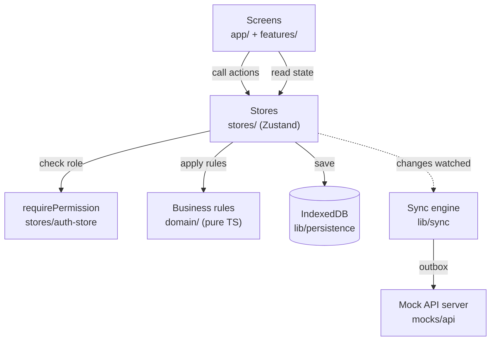
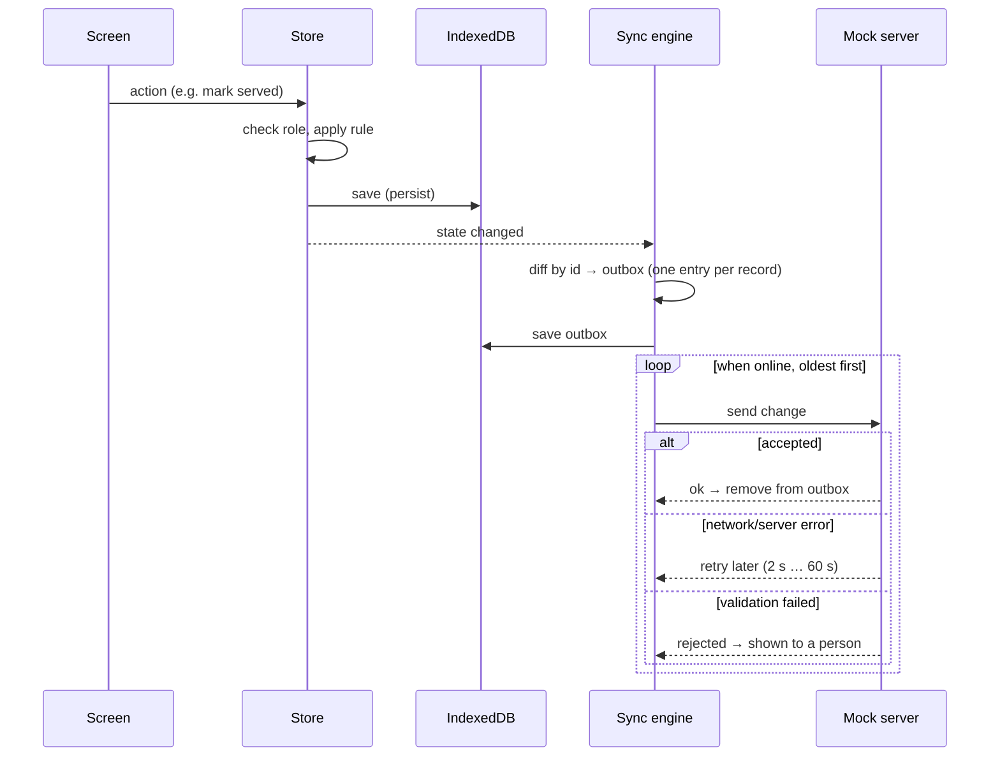

# Architecture

How the code is organised, how data flows, and why it's built this way.

- [Layers](#layers)
- [What happens when you tap a button](#what-happens-when-you-tap-a-button)
- [Folders](#folders)
- [Offline-first and sync](#offline-first-and-sync)
- [Rendering with Next.js 16](#rendering-with-nextjs-16)
- [Design system](#design-system)
- [Testing strategy](#testing-strategy)
- [Decisions](#decisions)

---

## Layers



| Layer       | Knows about React? | Job                                                                |
| ----------- | :----------------: | ------------------------------------------------------------------ |
| `domain/`   |         No         | The rules. Pure functions: same input → same output. Fully tested. |
| `stores/`   |     Hooks only     | Hold the data; each action checks the role, calls rules, saves.    |
| `features/` |        Yes         | The screens for one area of the restaurant.                        |
| `app/`      |        Yes         | Routes. Thin: arrange feature components, read URL params.         |
| `lib/`      |        Some        | Plumbing: persistence, sync engine, validation (Zod), helpers.     |

Rules never import React or a store, so they can be tested in milliseconds and explained
on their own.

## What happens when you tap a button

Example: a cashier taps **"Take ₹581.17 and finish"**.

1. **Screen** (`features/billing/components/payment-panel.tsx`) has already checked the
   input with the same rules (`checkPayment`) to show live change and errors. It calls
   `settleOrder(orderId, parts)` on the store.
2. **Store** (`stores/service-store.ts`):
   - `requirePermission("payment.take")`: is a cashier or manager logged in? Who is it?
   - `settleOrder(...)` from `domain/billing/checkout.ts` works the bill out **again** from
     the order, checks the parts add up, moves the order to paid, builds the payments and a
     frozen invoice, and decides which tables to free. If any rule fails, it throws and
     **nothing has changed yet**.
   - One `set()` saves order + payments + invoice + tables together.
3. **Persistence:** Zustand's `persist` writes the store to IndexedDB.
4. **Sync:** the engine sees four changed records and queues them in the outbox; it sends
   them to the mock server when online.
5. **Every screen** reading those stores re-renders: the table turns to Cleaning, the
   dashboard's sales go up, the invoice appears in transactions.

Because tables, orders, payments and invoices live in **one store**, a payment can never
leave the screen in a half-updated state (order paid but table still busy).

## Folders

```
src/
├── app/                      Routes
│   ├── (auth)/login/         Login, no sidebar: pick a user, then /login/[userId] for
│   │                         the PIN. A shared layout keeps the photo side in place.
│   │                         "/" redirects here (next.config.ts), so login is the home page.
│   ├── (pos)/                Every POS page; layout = app shell + AuthGate
│   ├── icon.tsx, apple-icon.tsx, manifest.ts   App icons from the logo, PWA manifest
│   └── dev/                  Design-system preview pages (/dev/theme, /dev/ui)
├── features/<area>/          Screens per area: auth, tables, orders, kitchen, billing,
│                             menu, dashboard, reports, settings, sync
├── components/
│   ├── ui/                   Buttons, dialogs, inputs, num pad, chips… (touch-sized)
│   ├── layout/               App shell, sidebar navigation, theme toggle
│   └── brand/                The logo (drawn in code)
├── domain/<area>/            Business rules + __tests__/
├── stores/                   service, menu, settings, cart, sync, auth
├── lib/
│   ├── persistence/          IndexedDB wrapper, storage adapter, "load saved data"
│   ├── sync/                 Sync engine (watch stores → outbox → server)
│   ├── validation/           Zod schemas for every form
│   ├── hooks/                useNow (hydration-safe clock)
│   └── utils/                cn(), ids, time formatting, tryAction()
├── mocks/
│   ├── data/                 Sample menu, photos, tables, orders, staff
│   └── api/                  Mock server + its validation rules
├── types/                    Shared record types
└── __tests__/                Integration tests (whole flows across stores)
```

## Offline-first and sync



- **Loading:** stores skip automatic hydration; `lib/persistence/load-saved-data.ts` reads
  all of them once in the browser, and `AuthGate` shows "Loading your restaurant data…"
  until then. The server and the browser's first paint render the same loading state, so
  there are no hydration mismatches.
- **Versioned data:** stores carry a version and a migration (the menu is at version 3: it
  added dish photos to menus saved before them).
- **Login** is kept in sessionStorage (survives refresh, not closing the tab).
- **A clean first visit.** The stores start with the sample menu, floor plan and staff, but
  no orders or bills. The sample service (`mocks/data/orders.ts`) is a function, run only
  when a manager loads it, so its times are always "now" (squeezed into the minutes since
  midnight early in the morning, so "earlier today" stays today). Saved sample data can
  never go stale on someone's device.
- **Change detection** compares records by object identity: stores always create new
  objects, so "different object" means "changed", with no deep comparison.
- **Service worker** (`public/sw.js`, production only): app files cache-first, pages
  network-first with a cached fallback, and an offline page for pages never opened.

## Rendering with Next.js 16

- **Cache Components** is on. Dynamic `params` are Promises, read inside `<Suspense>`.
- POS data lives in the browser, so POS pages render their content on the client after the
  saved data loads. The server sends the app shell and a loading state.
- Because of that, the dev-only "instant navigation" check is set to opt-in
  (`experimental.instantInsights.validationLevel: "manual-warning"`), otherwise it flags
  every POS page.
- Times ("placed 12 min ago", invoice dates) are written only in the browser (`useNow()`
  returns `null` on the server) so server and browser HTML match.
- Turbopack's on-disk **dev** cache is off (`turbopackFileSystemCacheForDev: false`):
  this project sits in a OneDrive folder, whose file syncing broke that cache and crashed
  the dev server. Builds are unaffected.

## Design system

- Colours are CSS variables in `src/app/globals.css`, inspired by the restaurant photo:
  teal velvet (primary), saffron/mustard (accent), walnut, brick (danger), leaf green
  (success), steel. Light mode is warm linen, dark mode is charcoal. Every text/background
  pair was checked for WCAG AA contrast.
- Components use names (`bg-primary`, `text-muted-foreground`), never hex codes.
- **Touch first:** controls are at least 44 px tall, big tap targets, a number pad for PINs
  and cash.
- **Not colour alone:** statuses always have words or icons too (table status, late
  tickets, veg marks, sold out).
- Printing an invoice hides the app frame and forces black on white.

## Testing strategy

- **Rules first** (`domain/**/__tests__`): every rule, edge cases, and rounding. Fast and
  exact.
- **Stores** (`stores/__tests__`): actions apply rules atomically, roles are enforced, a
  refused action changes nothing.
- **Integration** (`src/__tests__/service-day.test.ts`): a full service through every role;
  a list of illegal steps that must each leave the state untouched; 200 random orders whose
  bills, payments and reports must agree to the paisa (seeded, so reproducible).
- Tests run in Node (no browser). Screens were checked by hand in the browser at each step
  (phone and desktop widths, light and dark).

## Decisions

| Decision                                 | Why                                                                                      |
| ---------------------------------------- | ---------------------------------------------------------------------------------------- |
| Money in integer paise                   | Exact billing; no floating-point drift.                                                  |
| Rules as pure functions                  | Easy to test and reason about; the same rule serves screens, stores and the mock server. |
| One store for floor + orders + payments  | A payment changes several records; one `set()` keeps them consistent.                    |
| Zustand + IndexedDB, no backend          | The brief asks for a frontend with mock APIs and offline use.                            |
| Outbox sync, not "call the API and wait" | The till must work when the internet doesn't.                                            |
| Frozen invoices                          | Past bills must never change when prices, tax or details do.                             |
| Hand-built UI and charts                 | Touch sizing, theming and accessibility under full control; fewer dependencies.          |
| Role checks inside store actions         | Hiding buttons is not security.                                                          |
