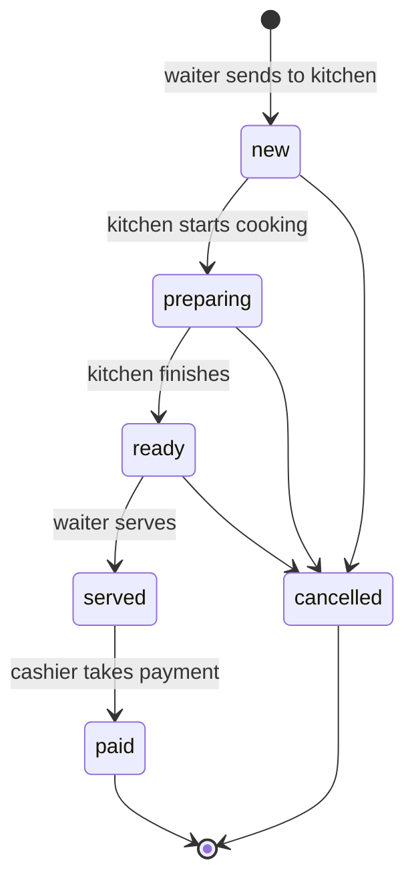
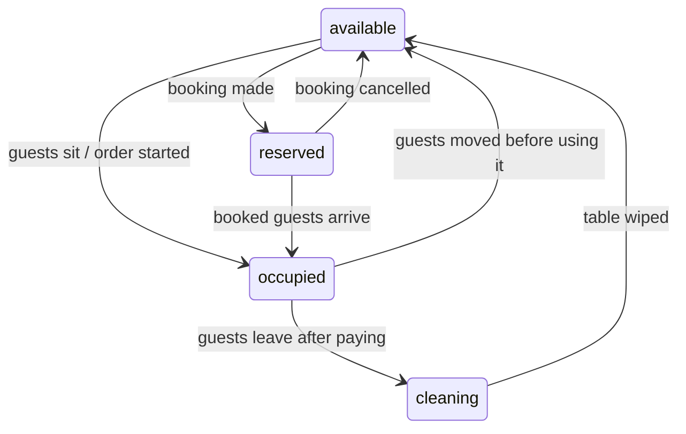

# Business rules

Every rule here is code in `src/domain/` (pure functions, no React) and has tests next to
it in `__tests__/`. Screens hide buttons that would break a rule; the rules themselves
still refuse, with a readable message, if something tries anyway.

- [Money](#money)
- [The bill](#the-bill)
- [Orders](#orders)
- [Tables](#tables)
- [Kitchen](#kitchen)
- [Payments and checkout](#payments-and-checkout)
- [Invoices](#invoices)
- [Roles and permissions](#roles-and-permissions)
- [Reports](#reports)
- [Sync](#sync)

---

## Money

`domain/money.ts`

- Amounts are **whole paise** (integers): ₹125.50 is `12550`. Never floating point, so
  `0.1 + 0.2` problems can't happen.
- Percentages are **basis points**: 1% = `100`, 12.5% = `1250`, also whole numbers.
- Percent of an amount uses exact integer (BigInt) maths and rounds **half up** to the
  nearest paisa.
- **Splitting** an amount (`allocate`) always gives parts that add up to exactly the total;
  leftover paise go to the parts that lost the most to rounding:
  `allocate(1000, [1, 1, 1]) → [334, 333, 333]`.
- Typed amounts are parsed without decimals: `"125.5"` → `12550`; more than 2 decimals is
  refused.

## The bill

`domain/billing/calculate-bill.ts`

1. Line total = (item price + add-ons + options) × quantity.
2. Cancelled items are not charged.
3. Subtotal = sum of line totals.
4. Discount = % of the subtotal, or a fixed amount, **never more than the subtotal**.
5. Taxable = subtotal − discount (GST is charged **after** the discount).
6. GST = rate × taxable, on the whole bill (not item by item).
7. Total = taxable + GST.

Rounding happens only twice: the discount and the GST, each half up to the paisa.

**Example** (INV-1003 in the sample data): ₹2,260.00 − 10% (₹226.00) = ₹2,034.00;
GST 5% = ₹101.70; **total ₹2,135.70**. On the invoice GST is shown as CGST ₹50.85 +
SGST ₹50.85 (split with `allocate`, so the halves always add up).

The GST rate comes from Settings (0, 5, 12 or 18%) and applies to every bill not yet
paid. Paid invoices keep the rate they were paid with.

## Orders

`domain/orders/`

- Nothing moves backwards, and **paid** and **cancelled** are final.
- Food that has been served must be paid for: no cancelling after **served**.
- Starting to cook needs at least one active item. Cancelling needs a reason.
- Every move is recorded in the order's timeline: status, time and **who** did it.
- **Order lines copy** the dish name and prices at the time of ordering, so a later menu
  change never alters an existing order.
- **Choices:** a dish with sizes needs exactly one; each option group needs between its
  minimum and maximum choices; only add-ons the dish offers; quantity 1–99; sold-out dishes
  can't be ordered. The same dish with the same choices adds up on one line.
- **Adding dishes** to an existing order: only while it's new or preparing. After that,
  extra dishes are a new order for the table ("another round"), a fresh kitchen ticket.
- **Cancelling one dish:** only while new or preparing, with a reason. It stays on the
  order, crossed out and not charged. Cancelling the last dish cancels the order.
- **Splitting an order** (separate bills): move some dishes, or part of a quantity, into a
  new order. At least one dish moves and at least one stays. The new order keeps the table,
  type and kitchen status (nothing is cooked twice). A discount stays on the original.
- Order numbers continue from the highest one: 101, 102, …

## Tables

`domain/tables/`

- A **dirty table can never be seated directly**: cleaning comes first.
- A table can hold **several open orders** (a second round, or split bills). It only
  becomes free when every one of them is paid or cancelled.
- A table with an open order can't be freed by hand: settle or move the order first.
- **Moving an order** goes to a free table only; the old table needs cleaning (or stays
  occupied if it still has other orders).
- **Joining tables** for a big group: only free tables can join a main table; every open
  order at the main table then covers the joined tables. **Separating** sends the joined
  tables to cleaning.
- After **payment**, the order's tables (and any joined to them) go to cleaning, unless
  another order is still open there.
- Floor plan: 12 × 8 grid, every table is the same size (2 × 2 cells), no overlaps, nothing
  outside the room. Only a free, unjoined table without orders can be removed.

## Kitchen

`domain/kitchen/`

- The board shows **new**, **preparing** and **ready** orders, **oldest first** in each
  column.
- A ticket's clock starts when the order was **placed** (the guest has waited since then);
  for ready tickets it counts time **at the pass**.
- **Amber** from 10 minutes, **red** from 15 (changeable in Settings). Only tickets still
  cooking can be late. Colours always come with words ("Getting late", "Late").
- "To cook now" adds up each dish (sizes counted separately) across new and preparing
  tickets, cancelled lines excluded.

## Payments and checkout

`domain/billing/payments.ts`, `checkout.ts`

- A bill can be paid in parts, with any mix of **cash, card and UPI**.
- Each part is more than ₹0 and **never more than what's still due**.
- Cash can be **more** than the part: the difference is change, worked out exactly.
- The order is settled only when the parts add up to the total **exactly**.
- **Split equally:** each guest's share comes from `allocate`, so the shares add up to the
  total (₹1,162.35 between 2 = ₹581.18 + ₹581.17).
- The discount is locked once a part payment has been added, so the total can't move
  under a guest who already paid.
- **Settling** happens all at once or not at all: the order must be **served**; the total
  is worked out **again from the order** (never trusted from the screen); then the order
  becomes paid, the payments and the invoice are saved, and the tables are freed.

## Invoices

- Numbered INV-1001, INV-1002, … in order.
- An invoice is a **frozen copy**: lines, prices, discount, GST rate and amounts, and the
  restaurant's details, as they were at payment. It never looks anything up again.

## Roles and permissions

`domain/auth/`

| Role    | Can                                                                                      |
| ------- | ---------------------------------------------------------------------------------------- |
| Manager | Everything                                                                               |
| Cashier | Dashboard, tables, orders, billing; create, split and cancel orders; discounts; payments |
| Waiter  | Tables and orders; create and split orders; serve; table status, move, join              |
| Kitchen | Kitchen and menu; start and finish cooking; mark dishes sold out                         |

- Each page needs a permission; the menu only lists pages the role can open, and opening
  another shows "This page isn't part of your role".
- **Every store action checks the permission again** and records who did it.
- Login: tap your name, then type the 4-digit PIN on your own page. 5 wrong PINs in a row
  lock the pad for 30 s (the count survives going back and choosing again). After login you
  return to the page that sent you to login, if your role may open it; otherwise to your
  role's start page.

## Reports

`domain/reports/sales-report.ts`

- Sales come from **invoices**, never live orders, so a past day always shows the same
  numbers.
- A sale belongs to the **day it was paid**, in the device's time zone.
- Dish sales are line totals **before** the bill's discount and GST (what each dish earned
  on the menu); discount and GST are shown once for the period.
- CSV export escapes commas and quotes, and starts with a BOM so Excel shows "₹".

## Sync

`domain/sync/outbox.ts`, `mocks/api/server-rules.ts`

- Every change is saved on the device first; the till never waits for the network.
- The outbox keeps **one entry per record** (the newest version wins).
- Sent oldest first. Network or server errors retry after 2 s, 4 s, 8 s … up to 60 s.
- The server checks every record again (bill totals, line totals, order number clashes
  between tills, prices, GST rate). **Rejected** data is not retried; a person can fix the
  record (it's sent again when it changes) or discard the change.
